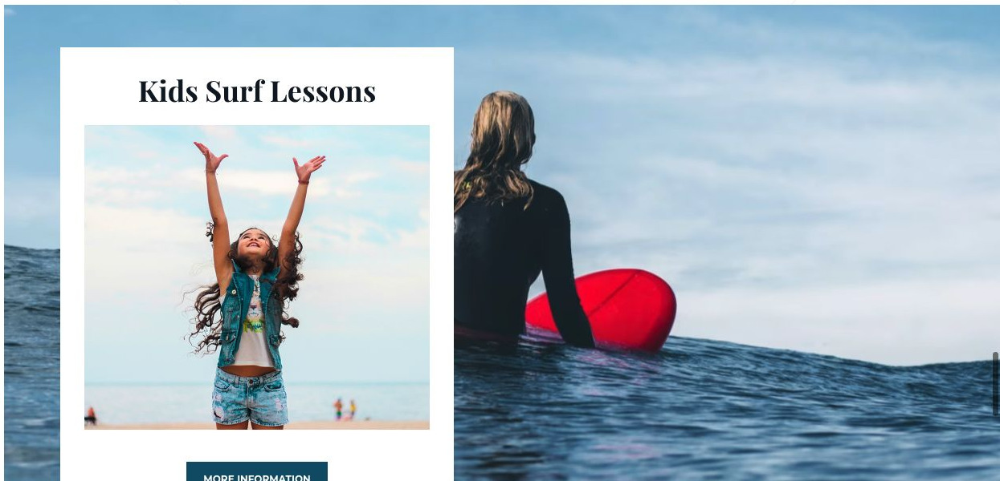

# Makai

[Indice del catalogo](../README.md) · [Scheda ufficiale](https://yootheme.com/joomla-templates/makai)

Layout e applicazioni dei widget nel tema. Le palette alternative sono escluse.

## We Closely Cooperate With Selected Brands to Ensure High Quality Equipment

**Slideshow** · Home Layout

Navigazione a puntini.

[Apri l’esempio](https://demo.yootheme.com/joomla/themes/makai/index.php)

## Layout censiti

I tipi elencati sono riconosciuti dal markup UIkit. Un componente può ripetersi in più layout o avere una versione desktop e una mobile. La tabella non conta preset univoci.

| Layout | Componenti rilevati | Stato |
|---|---|---|
| [Home Layout](https://demo.yootheme.com/joomla/themes/makai/index.php) | Grid × 6, Slideshow × 1 | HTML letto |
| [Services Layout](https://demo.yootheme.com/joomla/themes/makai/index.php?option=com_content&view=article&id=2&Itemid=108) | Grid × 4, Accordion × 1 | HTML letto |
| [Services Layout](https://demo.yootheme.com/joomla/themes/makai/index.php?option=com_content&view=article&id=6&Itemid=112) | Grid × 3, Panel Slider × 1, Slideshow × 1 | HTML letto |
| [Price List Layout](https://demo.yootheme.com/joomla/themes/makai/index.php?option=com_content&view=article&id=19&Itemid=118) | Panel Slider × 1, Grid × 2 | HTML letto |
| [About Layout](https://demo.yootheme.com/joomla/themes/makai/index.php?option=com_content&view=article&id=4&Itemid=110) | Grid × 5 | HTML letto |
| [Contact Layout](https://demo.yootheme.com/joomla/themes/makai/index.php?option=com_content&view=article&id=3&Itemid=109) | Grid × 2, Map × 1 | HTML letto |
| [Post Index Layout](https://demo.yootheme.com/joomla/themes/makai/index.php?option=com_content&view=category&layout=blog&id=8&Itemid=119) | Grid × 1 | HTML letto |
| [Post Layout](https://demo.yootheme.com/joomla/themes/makai/index.php?option=com_content&view=article&id=11&catid=8&Itemid=119) | Nessun componente delle famiglie rilevate | HTML letto |

## Riferimenti nel layout

### Home Layout

- Grid: Everything You Need to Learn How to Catch Epic Waves.
- Grid: Everything You Need to Learn How to Catch Epic Waves.
- Grid: Take a Break and Relax in Our Cozy Club House.
- Grid: We will help you find the right board!.
- Grid: We Closely Cooperate With Selected Brands to Ensure High Quality Equipment.
- Grid: We Closely Cooperate With Selected Brands to Ensure High Quality Equipment.
- Slideshow: We Closely Cooperate With Selected Brands to Ensure High Quality Equipment.

### Services Layout

- Grid: Beginners Surf Course.
- Grid: Advanced Surf Course.
- Grid: Kids Surf Course.
- Grid: Corporate Surf Course.
- Accordion: Frequently Asked Questions.

### Services Layout

- Grid: Everything for an Amazing Surf Holiday.
- Panel Slider: Create Unforget­table Moments.
- Slideshow: Create Unforget­table Moments.
- Grid: Feel at Home at Our Comfortable Resort.
- Grid: That’s What You Can Expect on a Typical Day.

### Price List Layout

- Panel Slider: (inizio pagina).
- Grid: We Have Surfboards for All Conditions and Skill Levels.
- Grid: We Care About Your Surfboard and Gear.

### About Layout

- Grid: Everything Started in 2012.
- Grid: Surfing is a Way of Life and not Just a Sport.
- Grid: Learn From Our Team of Friendly Professionals.
- Grid: Learn From Our Team of Friendly Professionals.
- Grid: Some of the Certificates We Received in the Last Few Years.

### Contact Layout

- Grid: (inizio pagina).
- Map: Socials.
- Grid: Makai Surf School Is Easily Accessible via Car, Train and from Porto Airport.

### Post Index Layout

- Grid: Explore More Interesting Stories About Surfing.

