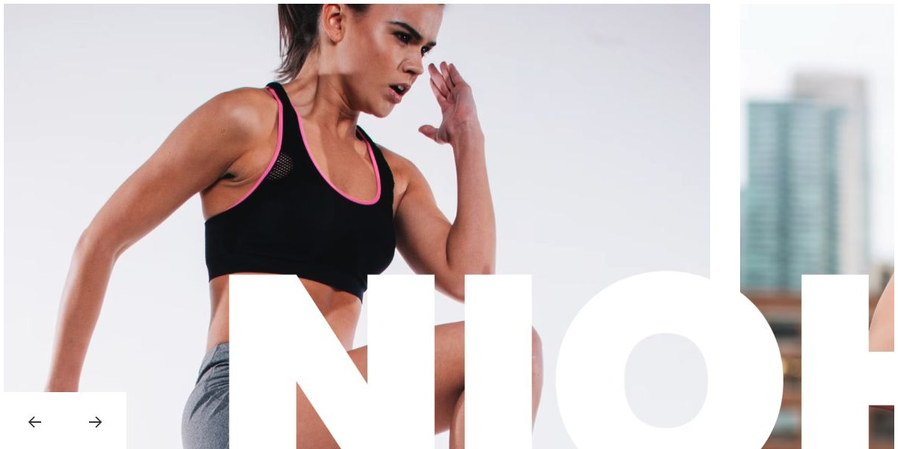

# Nioh Studio

[Indice del catalogo](../README.md) · [Scheda ufficiale](https://yootheme.com/joomla-templates/nioh-studio)

Layout e applicazioni dei widget nel tema. Le palette alternative sono escluse.

## Work Out Stay Strong

**Panel Slider** · Home Layout

Schede con contenuto separato dal media. Effetti di transizione presenti nel markup.

[Apri l’esempio](https://demo.yootheme.com/joomla/themes/nioh-studio/index.php)

## Layout censiti

I tipi elencati sono riconosciuti dal markup UIkit. Un componente può ripetersi in più layout o avere una versione desktop e una mobile. La tabella non conta preset univoci.

| Layout | Componenti rilevati | Stato |
|---|---|---|
| [Home Layout](https://demo.yootheme.com/joomla/themes/nioh-studio/index.php) | Panel Slider × 1, Grid × 2, Button × 1 | HTML letto |
| [About Layout](https://demo.yootheme.com/joomla/themes/nioh-studio/index.php?option=com_content&view=article&id=34&Itemid=132) | Grid × 2 | HTML letto |
| [Services Layout](https://demo.yootheme.com/joomla/themes/nioh-studio/index.php?option=com_content&view=article&id=37&Itemid=136) | Button × 3, Map × 1 | HTML letto |
| [Menu Layout](https://demo.yootheme.com/joomla/themes/nioh-studio/index.php?option=com_content&view=article&id=2&Itemid=108) | Slideshow × 3 | HTML letto |
| [Schedule Layout](https://demo.yootheme.com/joomla/themes/nioh-studio/index.php?option=com_content&view=article&id=32&Itemid=133) | Overlay Slider × 1 | HTML letto |
| [Service Post Layout](https://demo.yootheme.com/joomla/themes/nioh-studio/index.php?option=com_content&view=article&id=36&Itemid=137) | Nessun componente delle famiglie rilevate | HTML letto |
| [Service Post Layout](https://demo.yootheme.com/joomla/themes/nioh-studio/index.php?option=com_content&view=article&id=30&Itemid=130) | Button × 1 | HTML letto |
| [Service Post Layout](https://demo.yootheme.com/joomla/themes/nioh-studio/index.php?option=com_content&view=article&id=33&Itemid=138) | Grid × 2, Button × 1 | HTML letto |
| [Trainers Index Layout](https://demo.yootheme.com/joomla/themes/nioh-studio/index.php?option=com_content&view=article&id=31&Itemid=131) | Nessun componente delle famiglie rilevate | HTML letto |
| [Trainer Post Layout](https://demo.yootheme.com/joomla/themes/nioh-studio/index.php?option=com_content&view=article&id=38&Itemid=139) | Grid × 1 | HTML letto |
| [Pricing Layout](https://demo.yootheme.com/joomla/themes/nioh-studio/index.php?option=com_content&view=article&id=35&Itemid=135) | Grid × 1 | HTML letto |
| [Contact Layout](https://demo.yootheme.com/joomla/themes/nioh-studio/index.php?option=com_content&view=article&id=39&Itemid=134) | Grid × 2, Map × 1 | HTML letto |
| [Post Index Layout](https://demo.yootheme.com/joomla/themes/nioh-studio/index.php?option=com_content&view=category&layout=blog&id=8&Itemid=117) | Grid × 1 | HTML letto |
| [Post Layout](https://demo.yootheme.com/joomla/themes/nioh-studio/index.php?option=com_content&view=article&id=10&catid=8&Itemid=117) | Nessun componente delle famiglie rilevate | HTML letto |

## Riferimenti nel layout

### Home Layout

- Panel Slider: Work Out Stay Strong.
- Grid: Our Services.
- Grid: Start Your Work­out.
- Button: Start Your Work­out.

### About Layout

- Grid: Family club.
- Grid: Your Benefits.

### Services Layout

- Button: Resistance Training.
- Button: 50+ Group Classes.
- Button: Strength & Conditioning.
- Map: High Intensity Training.

### Menu Layout

- Slideshow: Restau­rant.
- Slideshow: Breakfast.
- Slideshow: Lunch.

### Schedule Layout

- Overlay Slider: Classes.

### Service Post Layout

- Button: Make an Appoint­ment.

### Service Post Layout

- Grid: Treatment Spectrum.
- Button: Therapy Services.
- Grid: Physiotherapists.

### Trainer Post Layout

- Grid: My Classes.

### Pricing Layout

- Grid: Our Pricings.

### Contact Layout

- Grid: Our Locations.
- Map: Charlottenburg.
- Grid: Contact us.

### Post Index Layout

- Grid: Health care and nutrition tips.

