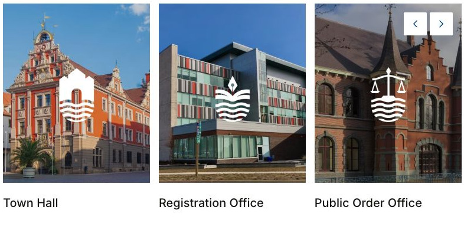

# Oakville

[Indice del catalogo](../README.md) · [Scheda ufficiale](https://yootheme.com/joomla-templates/oakville)

Layout e applicazioni dei widget nel tema. Le palette alternative sono escluse.

## Our Authorities

**Panel Slider** · Home Layout

Schede con contenuto separato dal media.

[Apri l’esempio](https://demo.yootheme.com/joomla/themes/oakville/index.php)

## Layout censiti

I tipi elencati sono riconosciuti dal markup UIkit. Un componente può ripetersi in più layout o avere una versione desktop e una mobile. La tabella non conta preset univoci.

| Layout | Componenti rilevati | Stato |
|---|---|---|
| [Home Layout](https://demo.yootheme.com/joomla/themes/oakville/index.php) | Grid × 11, Panel Slider × 1 | HTML letto |
| [Map Layout](https://demo.yootheme.com/joomla/themes/oakville/index.php?option=com_content&view=article&id=1184&Itemid=429) | Map × 1 | HTML letto |
| [News and Events Layout](https://demo.yootheme.com/joomla/themes/oakville/index.php?option=com_content&view=article&id=1264&Itemid=117) | Grid × 5 | HTML letto |
| [Imprint Layout](https://demo.yootheme.com/joomla/themes/oakville/index.php?option=com_content&view=article&id=262:imprint&catid=2&Itemid=101) | Nessun componente delle famiglie rilevate | HTML letto |
| [Error 404 Layout](https://demo.yootheme.com/joomla/themes/oakville/404) | Nessun componente delle famiglie rilevate | Pagina 404 dimostrativa |
| [Place Index Layout](https://demo.yootheme.com/joomla/themes/oakville/index.php?option=com_content&view=category&layout=blog&id=9&Itemid=119) | Grid × 8 | HTML letto |
| [Place Category Layout](https://demo.yootheme.com/joomla/themes/oakville/index.php?option=com_content&view=category&id=13&Itemid=415) | Panel Slider × 8 | HTML letto |
| [Place Subcategory Layout](https://demo.yootheme.com/joomla/themes/oakville/index.php?option=com_content&view=category&id=11&Itemid=414) | Nessun componente delle famiglie rilevate | HTML letto |
| [Place Post Layout](https://demo.yootheme.com/joomla/themes/oakville/index.php?option=com_content&view=article&id=1268:oakville-cultural-center&catid=180&Itemid=420) | Gallery × 2, Grid × 2, Map × 1 | HTML letto |
| [Authority Index Layout](https://demo.yootheme.com/joomla/themes/oakville/index.php?option=com_content&view=category&layout=blog&id=175&Itemid=133) | Grid × 2 | HTML letto |
| [Authority Post Layout](https://demo.yootheme.com/joomla/themes/oakville/index.php?option=com_content&view=article&id=440:town-hall&catid=175&Itemid=476) | Accordion × 1, Gallery × 2, Grid × 3, Map × 1 | HTML letto |
| [Announcement Index Layout](https://demo.yootheme.com/joomla/themes/oakville/index.php?option=com_content&view=category&layout=blog&id=36&Itemid=318) | Grid × 9 | HTML letto |
| [Announcement Category Layout](https://demo.yootheme.com/joomla/themes/oakville/index.php?option=com_content&view=category&id=30&Itemid=318) | Grid × 2 | HTML letto |
| [Announcement Post Layout](https://demo.yootheme.com/joomla/themes/oakville/index.php?option=com_content&view=article&id=978:central-town-square-redevelopment-plan-2024&catid=29&Itemid=318) | Grid × 1 | HTML letto |
| [Download Index Layout](https://demo.yootheme.com/joomla/themes/oakville/index.php?option=com_content&view=category&layout=blog&id=37&Itemid=316) | Nessun componente delle famiglie rilevate | HTML letto |
| [Download Category Layout](https://demo.yootheme.com/joomla/themes/oakville/index.php?option=com_content&view=category&id=128&Itemid=316) | Grid × 4 | HTML letto |
| [Download Post Layout](https://demo.yootheme.com/joomla/themes/oakville/index.php?option=com_content&view=article&id=1261:oakville-administrative-structure&catid=128&Itemid=316) | Button × 1 | HTML letto |
| [Service Index Layout](https://demo.yootheme.com/joomla/themes/oakville/index.php?option=com_content&view=category&layout=blog&id=49&Itemid=139) | Grid × 1 | HTML letto |
| [Service Category Layout](https://demo.yootheme.com/joomla/themes/oakville/index.php?option=com_content&view=category&id=153&Itemid=139) | Grid × 1 | HTML letto |
| [Service Post Layout](https://demo.yootheme.com/joomla/themes/oakville/index.php?option=com_content&view=article&id=451:bicycle-registration&catid=153&Itemid=139) | Nessun componente delle famiglie rilevate | HTML letto |
| [Official Index Layout](https://demo.yootheme.com/joomla/themes/oakville/index.php?option=com_content&view=category&layout=blog&id=34&Itemid=317) | Grid × 3 | HTML letto |
| [Official Category Layout](https://demo.yootheme.com/joomla/themes/oakville/index.php?option=com_content&view=category&id=92&Itemid=317) | Nessun componente delle famiglie rilevate | HTML letto |
| [Official Post Layout](https://demo.yootheme.com/joomla/themes/oakville/index.php?option=com_content&view=article&id=1269:stephen-baker&catid=92&Itemid=317) | Grid × 1 | HTML letto |
| [Topic Index Layout](https://demo.yootheme.com/joomla/themes/oakville/index.php?option=com_content&view=category&layout=blog&id=146&Itemid=128) | Grid × 9 | HTML letto |
| [Topic Category Layout](https://demo.yootheme.com/joomla/themes/oakville/index.php?option=com_content&view=category&id=151&Itemid=120) | Grid × 1 | HTML letto |
| [Topic Post Layout](https://demo.yootheme.com/joomla/themes/oakville/index.php?option=com_content&view=article&id=20:about-oakville&catid=151&Itemid=120) | Slideshow × 1, Grid × 1 | HTML letto |
| [Topic Post List Layout](https://demo.yootheme.com/joomla/themes/oakville/index.php?option=com_content&view=article&id=21:history&catid=151&Itemid=120) | Slideshow × 1, Grid × 2 | HTML letto |
| [Topic Post Table Layout](https://demo.yootheme.com/joomla/themes/oakville/index.php?option=com_content&view=article&id=22:facts-and-numbers&catid=151&Itemid=120) | Slideshow × 1, Grid × 2 | HTML letto |
| [Topic Post Tabs Layout](https://demo.yootheme.com/joomla/themes/oakville/index.php?option=com_content&view=article&id=1091:renewable-energy&catid=148&Itemid=333) | Slideshow × 1, Grid × 1 | HTML letto |
| [Post Index Layout](https://demo.yootheme.com/joomla/themes/oakville/index.php?option=com_content&view=category&layout=blog&id=8&Itemid=483) | Nessun componente delle famiglie rilevate | HTML letto |
| [Post Layout](https://demo.yootheme.com/joomla/themes/oakville/index.php?option=com_content&view=article&id=1256:oakville-mayor-delivers-key-address-on-the-future-of-the-town-at-the-annual-press-conference&catid=35&Itemid=435) | Map × 1, Grid × 3 | HTML letto |
| [Event Index Layout](https://demo.yootheme.com/joomla/themes/oakville/index.php?option=com_content&view=category&layout=blog&id=176&Itemid=321) | Grid × 28 | HTML letto |
| [Event Post Layout](https://demo.yootheme.com/joomla/themes/oakville/index.php?option=com_content&view=article&id=1253:open-day-at-the-fire-brigade&catid=183&Itemid=493) | Map × 1, Grid × 1 | HTML letto |
| [Search Layout](https://demo.yootheme.com/joomla/themes/oakville/index.php?q=day&option=com_finder&view=search&Itemid=101&f=1) | Grid × 2 | HTML letto |

## Riferimenti nel layout

### Home Layout

- Grid: Municipality of Oakville.
- Grid: Municipality of Oakville.
- Grid: In the News.
- Grid: In the News.
- Grid: In the News.
- Grid: In the News.
- Grid: In the News.
- Grid: Upcoming Events.
- Grid: Upcoming Events.
- Grid: Upcoming Events.
- Grid: Upcoming Events.
- Panel Slider: Our Authorities.

### Map Layout

- Map: (inizio pagina).

### News and Events Layout

- Grid: Latest News.
- Grid: Latest News.
- Grid: Upcoming Events.
- Grid: Upcoming Events.
- Grid: Upcoming Events.

### Place Index Layout

- Grid: Living in Oakville.
- Grid: Education & Family.
- Grid: Recreation.
- Grid: Tourism.
- Grid: Associa­tions & Clubs.
- Grid: Emergency Assistance.
- Grid: Retirement Care.
- Grid: Churches & Welfare.

### Place Category Layout

- Panel Slider: Sports Facilities.
- Panel Slider: Sports Facilities.
- Panel Slider: Sports Clubs.
- Panel Slider: Sports Clubs.
- Panel Slider: Play­grounds.
- Panel Slider: Play­grounds.
- Panel Slider: Parks and Trails.
- Panel Slider: Parks and Trails.

### Place Post Layout

- Gallery: Gallery.
- Gallery: Gallery.
- Grid: Upcoming Events.
- Grid: Upcoming Events.
- Map: Contact Information.

### Authority Index Layout

- Grid: Popular Services.
- Grid: Popular Forms & Permits.

### Authority Post Layout

- Accordion: Relevant Topics.
- Gallery: Gallery.
- Gallery: Gallery.
- Grid: Latest Announcements.
- Map: Contact Information.
- Grid: Downloads.
- Grid: Services.

### Announcement Index Layout

- Grid: Announce­ments.
- Grid: Press Releases.
- Grid: Press Releases.
- Grid: Construction Sites.
- Grid: Construction Sites.
- Grid: Building Permits.
- Grid: Building Permits.
- Grid: Building Projects.
- Grid: Building Projects.

### Announcement Category Layout

- Grid: Press Releases.
- Grid: Closure of the Town Hall From 15.12. to 07.01.24.

### Announcement Post Layout

- Grid: Downloads.

### Download Category Layout

- Grid: Town Hall Downloads.
- Grid: Forms.
- Grid: Meeting Minutes & Agendas.
- Grid: Public Ordinances & Regulations.

### Download Post Layout

- Button: Oakville Administrative Structure.

### Service Index Layout

- Grid: How do I?.

### Service Category Layout

- Grid: Town Hall Services.

### Official Index Layout

- Grid: Public Officials.
- Grid: Public Officials.
- Grid: Public Officials.

### Official Post Layout

- Grid: About.

### Topic Index Layout

- Grid: Topics in Our Community.
- Grid: Discover Oakville.
- Grid: Traffic.
- Grid: Environment.
- Grid: Climate & Sustainability.
- Grid: Economy & Trade.
- Grid: Planning.
- Grid: Infrastructure.
- Grid: Security & Order.

### Topic Category Layout

- Grid: Discover Oakville.

### Topic Post Layout

- Slideshow: About Oakville.
- Grid: External Links.

### Topic Post List Layout

- Slideshow: History.
- Grid: History.
- Grid: External Links.

### Topic Post Table Layout

- Slideshow: Facts and Numbers.
- Grid: External Links.
- Grid: Downloads.

### Topic Post Tabs Layout

- Slideshow: Renewable Energy.
- Grid: Downloads.

### Post Layout

- Map: Contact Information.
- Grid: External Links.
- Grid: Related News.
- Grid: Related News.

### Event Index Layout

- Grid: January.
- Grid: January.
- Grid: January.
- Grid: January.
- Grid: March.
- Grid: March.
- Grid: May.
- Grid: May.
- Grid: June.
- Grid: June.
- Grid: July.
- Grid: July.
- Grid: July.
- Grid: July.
- Grid: July.
- Grid: July.
- Grid: August.
- Grid: August.
- Grid: September.
- Grid: September.
- Grid: October.
- Grid: October.
- Grid: November.
- Grid: November.
- Grid: November.
- Grid: November.
- Grid: December.
- Grid: December.

### Event Post Layout

- Map: Event Information.
- Grid: External Links.

### Search Layout

- Grid: 13 items found.
- Grid: 13 items found.

