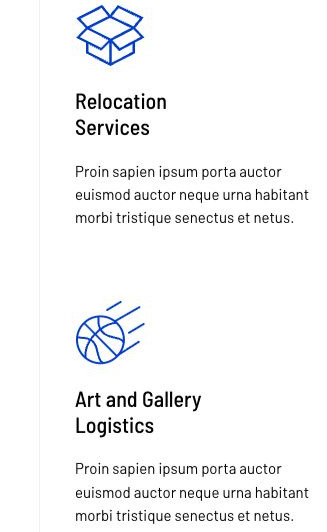

# Tomsen Brody

[Indice del catalogo](../README.md) · [Scheda ufficiale](https://yootheme.com/joomla-templates/tomsen-brody)

Layout e applicazioni dei widget nel tema. Le palette alternative sono escluse.

## Special Transports

**Grid** · Home Layout

[Apri l’esempio](https://demo.yootheme.com/joomla/themes/tomsen-brody/index.php)

## Layout censiti

I tipi elencati sono riconosciuti dal markup UIkit. Un componente può ripetersi in più layout o avere una versione desktop e una mobile. La tabella non conta preset univoci.

| Layout | Componenti rilevati | Stato |
|---|---|---|
| [Home Layout](https://demo.yootheme.com/joomla/themes/tomsen-brody/index.php) | Grid × 2 | HTML letto |
| [Services Layout](https://demo.yootheme.com/joomla/themes/tomsen-brody/index.php?option=com_content&view=article&id=2&Itemid=119) | Grid × 1, Button × 1 | HTML letto |
| [Service Post Layout](https://demo.yootheme.com/joomla/themes/tomsen-brody/index.php?option=com_content&view=article&id=3&Itemid=120) | Grid × 1 | HTML letto |
| [Service Post Layout](https://demo.yootheme.com/joomla/themes/tomsen-brody/index.php?option=com_content&view=article&id=8&Itemid=113) | Grid × 2, Accordion × 1 | HTML letto |
| [About Layout](https://demo.yootheme.com/joomla/themes/tomsen-brody/index.php?option=com_content&view=article&id=6&Itemid=112) | Grid × 5 | HTML letto |
| [Sustainability Layout](https://demo.yootheme.com/joomla/themes/tomsen-brody/index.php?option=com_content&view=article&id=5&Itemid=111) | Nessun componente delle famiglie rilevate | HTML letto |
| [Contact Layout](https://demo.yootheme.com/joomla/themes/tomsen-brody/index.php?option=com_content&view=article&id=4&Itemid=110) | Button × 1, Grid × 2 | HTML letto |
| [Imprint Layout](https://demo.yootheme.com/joomla/themes/tomsen-brody/index.php?option=com_content&view=article&id=19&Itemid=118) | Nessun componente delle famiglie rilevate | HTML letto |
| [Post Index Layout](https://demo.yootheme.com/joomla/themes/tomsen-brody/index.php?option=com_content&view=category&layout=blog&id=8&Itemid=117) | Grid × 1 | HTML letto |
| [Post Layout](https://demo.yootheme.com/joomla/themes/tomsen-brody/index.php?option=com_content&view=article&id=10&catid=8&Itemid=117) | Grid × 1 | HTML letto |

## Riferimenti nel layout

### Home Layout

- Grid: Special Transports.
- Grid: Special Transports.

### Services Layout

- Grid: Special Transports.
- Button: Customer Solutions.

### Service Post Layout

- Grid: Related Products.

### Service Post Layout

- Grid: Downloads.
- Accordion: FAQ.
- Grid: Related Products.

### About Layout

- Grid: Facts & Data.
- Grid: Facts & Data.
- Grid: Facts & Data.
- Grid: Facts & Data.
- Grid: Company Management.

### Contact Layout

- Button: Get in Touch.
- Grid: Get in Touch.
- Grid: London.

### Post Index Layout

- Grid: News + Events.

### Post Layout

- Grid: Popular Articles.

