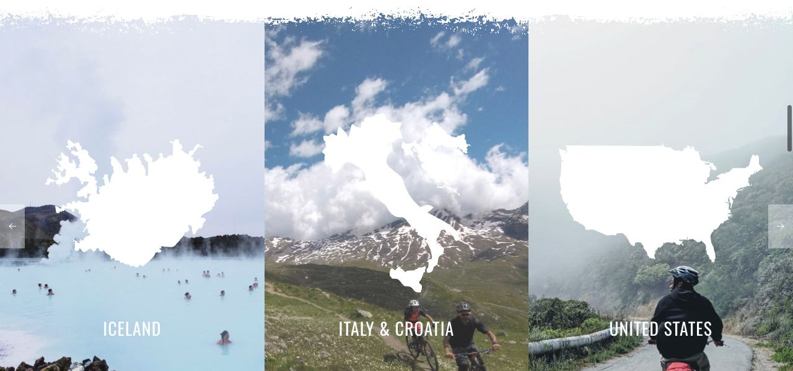

# Trek

[Indice del catalogo](../README.md) · [Scheda ufficiale](https://yootheme.com/joomla-templates/trek)

Layout e applicazioni dei widget nel tema. Le palette alternative sono escluse.

## Plan Your Perfect Trip

**Panel Slider** · Home Layout

Schede con contenuto separato dal media. Effetti di transizione presenti nel markup.

[Apri l’esempio](https://demo.yootheme.com/joomla/themes/trek/index.php)

## Layout censiti

I tipi elencati sono riconosciuti dal markup UIkit. Un componente può ripetersi in più layout o avere una versione desktop e una mobile. La tabella non conta preset univoci.

| Layout | Componenti rilevati | Stato |
|---|---|---|
| [Home Layout](https://demo.yootheme.com/joomla/themes/trek/index.php) | Panel Slider × 1 | HTML letto |
| [Routes Layout](https://demo.yootheme.com/joomla/themes/trek/index.php?option=com_content&view=article&id=2&Itemid=108) | Grid × 1 | HTML letto |
| [Route Post Layout](https://demo.yootheme.com/joomla/themes/trek/index.php?option=com_content&view=article&id=5&Itemid=111) | Grid × 3, Map × 1, Slideshow × 1 | HTML letto |
| [Tips Layout](https://demo.yootheme.com/joomla/themes/trek/index.php?option=com_content&view=article&id=6&Itemid=112) | Panel Slider × 1, Accordion × 1, Button × 1, Grid × 1 | HTML letto |
| [Gear Layout](https://demo.yootheme.com/joomla/themes/trek/index.php?option=com_content&view=article&id=8&Itemid=113) | Switcher × 2, Grid × 1 | HTML letto |
| [Gear Post Layout](https://demo.yootheme.com/joomla/themes/trek/index.php?option=com_content&view=article&id=3&Itemid=109) | Slideshow × 1, Switcher × 1, Accordion × 1 | HTML letto |
| [Portfolio Layout](https://demo.yootheme.com/joomla/themes/trek/index.php?option=com_content&view=article&id=4&Itemid=110) | Nessun componente delle famiglie rilevate | HTML letto |
| [Post Index Layout](https://demo.yootheme.com/joomla/themes/trek/index.php?option=com_content&view=category&layout=blog&id=8&Itemid=117) | Grid × 1 | HTML letto |
| [Post Layout](https://demo.yootheme.com/joomla/themes/trek/index.php?option=com_content&view=article&id=10&catid=8&Itemid=117) | Grid × 1 | HTML letto |

## Riferimenti nel layout

### Home Layout

- Panel Slider: Plan Your Perfect Trip.

### Routes Layout

- Grid: Routes by Country.

### Route Post Layout

- Grid: An Advanced Trail from West to East.
- Grid: An Advanced Trail from West to East.
- Map: Tours and Stop­overs.
- Slideshow: Tours and Stop­overs.
- Grid: Similar Routes.

### Tips Layout

- Panel Slider: Choosing Your Ride.
- Accordion: Bike­packing Gear.
- Button: Plan Your Route.
- Grid: Resources and Links.

### Gear Layout

- Switcher: Velvø Touring Bike.
- Switcher: Trek Supply Travel Backpack.
- Grid: Product Reviews.

### Gear Post Layout

- Slideshow: The All­rounder.
- Switcher: A Roadbike for Beginners.
- Accordion: Bike Specs.

### Post Index Layout

- Grid: Journal.

### Post Layout

- Grid: Latest Articles.

