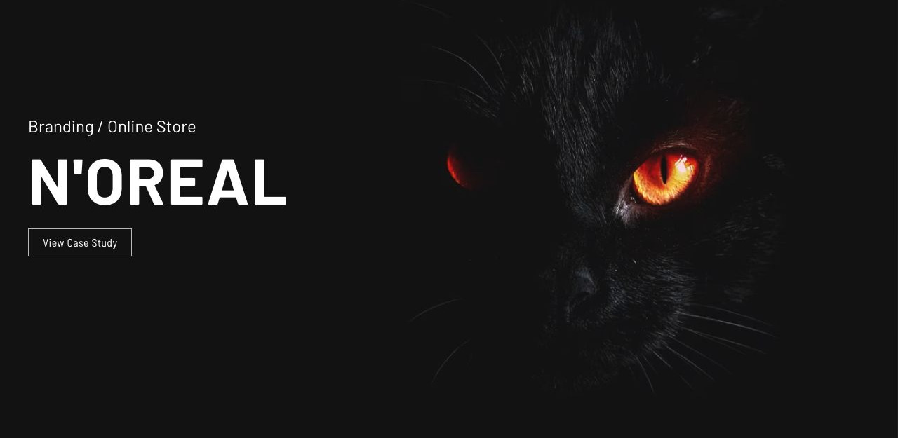

# Vision

[Indice del catalogo](../README.md) · [Scheda ufficiale](https://yootheme.com/joomla-templates/vision)

Layout e applicazioni dei widget nel tema. Le palette alternative sono escluse.

## Things we've made

**Overlay Slider** · Home Layout

Tre progetti affiancati nel desktop, distanze più ampie e navigazione a puntini. Titoli e azioni sono sovrapposti al media con transizioni; il markup imposta avanzamento per gruppi. Utile per portfolio e lavori da esplorare.

[Apri l’esempio](https://demo.yootheme.com/joomla/themes/vision/index.php)

## Showcase

**Overlay Slider** · Portfolio Layout

Carosello centrato di progetti con testo sovrapposto, frecce e puntini. Il markup configura avanzamento automatico ogni 6 secondi.

[Apri l’esempio](https://demo.yootheme.com/joomla/themes/vision/index.php?option=com_content&view=article&id=8&Itemid=119)

## Portfolio Layout

**Slideshow** · Portfolio Layout

Navigazione a puntini.

[Apri l’esempio](https://demo.yootheme.com/joomla/themes/vision/index.php?option=com_content&view=article&id=2&Itemid=108)

## Layout censiti

I tipi elencati sono riconosciuti dal markup UIkit. Un componente può ripetersi in più layout o avere una versione desktop e una mobile. La tabella non conta preset univoci.

| Layout | Componenti rilevati | Stato |
|---|---|---|
| [Home Layout](https://demo.yootheme.com/joomla/themes/vision/index.php) | Grid × 2, Overlay Slider × 1 | HTML letto |
| [Services Layout](https://demo.yootheme.com/joomla/themes/vision/index.php?option=com_content&view=article&id=6&Itemid=112) | Grid × 1 | HTML letto |
| [Portfolio Layout](https://demo.yootheme.com/joomla/themes/vision/index.php?option=com_content&view=article&id=2&Itemid=108) | Slideshow × 1, Gallery × 1 | HTML letto |
| [Portfolio Layout](https://demo.yootheme.com/joomla/themes/vision/index.php?option=com_content&view=article&id=8&Itemid=119) | Overlay Slider × 1 | HTML letto |
| [Case Study Layout](https://demo.yootheme.com/joomla/themes/vision/index.php?option=com_content&view=article&id=20&Itemid=118) | Gallery × 1 | HTML letto |
| [About Layout](https://demo.yootheme.com/joomla/themes/vision/index.php?option=com_content&view=article&id=4&Itemid=110) | Grid × 3 | HTML letto |
| [Contact Layout](https://demo.yootheme.com/joomla/themes/vision/index.php?option=com_content&view=article&id=19&Itemid=113) | Nessun componente delle famiglie rilevate | HTML letto |
| [Post Index Layout](https://demo.yootheme.com/joomla/themes/vision/index.php?option=com_content&view=category&layout=blog&id=8&Itemid=117) | Grid × 1 | HTML letto |
| [Post Layout](https://demo.yootheme.com/joomla/themes/vision/index.php?option=com_content&view=article&id=10&catid=8&Itemid=117) | Nessun componente delle famiglie rilevate | HTML letto |

## Riferimenti nel layout

### Home Layout

- Grid: Digital Pioneers.
- Overlay Slider: Things we've made.
- Grid: Our Clients.

### Services Layout

- Grid: Our Services.

### Portfolio Layout

- Slideshow: (inizio pagina).
- Gallery: Selected Works.

### Portfolio Layout

- Overlay Slider: Showcase.

### Case Study Layout

- Gallery: The Goal.

### About Layout

- Grid: We are Vision.
- Grid: Founded in 2008.
- Grid: Clients we’ve worked for.

### Post Index Layout

- Grid: Our Journal.

