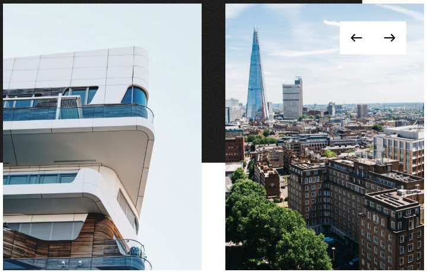

# Yard

[Indice del catalogo](../README.md) · [Scheda ufficiale](https://yootheme.com/joomla-templates/yard)

Layout e applicazioni dei widget nel tema. Le palette alternative sono escluse.

## About Us

**Panel Slider** · Home Layout

Schede con contenuto separato dal media. Effetti di transizione presenti nel markup.

[Apri l’esempio](https://demo.yootheme.com/joomla/themes/yard/index.php)

## Layout censiti

I tipi elencati sono riconosciuti dal markup UIkit. Un componente può ripetersi in più layout o avere una versione desktop e una mobile. La tabella non conta preset univoci.

| Layout | Componenti rilevati | Stato |
|---|---|---|
| [Home Layout](https://demo.yootheme.com/joomla/themes/yard/index.php) | Slideshow × 1, Grid × 2, Panel Slider × 2 | HTML letto |
| [Projects Layout](https://demo.yootheme.com/joomla/themes/yard/index.php?option=com_content&view=article&id=2&Itemid=108) | Grid × 1 | HTML letto |
| [Case Study Layout](https://demo.yootheme.com/joomla/themes/yard/index.php?option=com_content&view=article&id=20&Itemid=121) | Panel Slider × 1, Grid × 1 | HTML letto |
| [Portfolio Layout](https://demo.yootheme.com/joomla/themes/yard/index.php?option=com_content&view=article&id=6&Itemid=112) | Nessun componente delle famiglie rilevate | HTML letto |
| [Case Study Layout](https://demo.yootheme.com/joomla/themes/yard/index.php?option=com_content&view=article&id=19&Itemid=120) | Switcher × 2, Map × 1 | HTML letto |
| [About Layout](https://demo.yootheme.com/joomla/themes/yard/index.php?option=com_content&view=article&id=4&Itemid=110) | Grid × 2, Panel Slider × 1 | HTML letto |
| [Team Layout](https://demo.yootheme.com/joomla/themes/yard/index.php?option=com_content&view=article&id=8&Itemid=113) | Grid × 6 | HTML letto |
| [Person Layout](https://demo.yootheme.com/joomla/themes/yard/index.php?option=com_content&view=article&id=22&Itemid=122) | Overlay Slider × 1 | HTML letto |
| [Contact Layout](https://demo.yootheme.com/joomla/themes/yard/index.php?option=com_content&view=article&id=21&Itemid=118) | Nessun componente delle famiglie rilevate | HTML letto |
| [Post Index Layout](https://demo.yootheme.com/joomla/themes/yard/index.php?option=com_content&view=category&layout=blog&id=8&Itemid=117) | Grid × 1 | HTML letto |
| [Post Layout](https://demo.yootheme.com/joomla/themes/yard/index.php?option=com_content&view=article&id=10&catid=8&Itemid=117) | Grid × 1 | HTML letto |

## Riferimenti nel layout

### Home Layout

- Slideshow: (inizio pagina).
- Grid: About Us.
- Panel Slider: About Us.
- Panel Slider: Portfolio.
- Grid: News.

### Projects Layout

- Grid: Projects.

### Case Study Layout

- Panel Slider: Solution.
- Grid: Result.

### Case Study Layout

- Switcher: The Interior.
- Map: Within Walking Distance.
- Switcher: Amenities.

### About Layout

- Grid: History.
- Panel Slider: History.
- Grid: Main Services.

### Team Layout

- Grid: London.
- Grid: London.
- Grid: Singapore.
- Grid: Singapore.
- Grid: Amster­dam.
- Grid: Amster­dam.

### Person Layout

- Overlay Slider: Associated Projects.

### Post Index Layout

- Grid: News.

### Post Layout

- Grid: Latest Articles.

